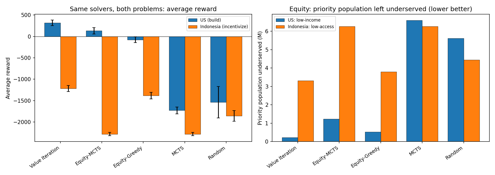

# Socially-Equitable Renewable Energy Budget Allocation MDPs

[](https://arxiv.org/abs/2607.10201)
[](https://github.com/ai-vnv/renewable-energy-mdp/actions/workflows/ci.yml)
[](https://www.python.org/downloads/)
[](LICENSE)

Reference implementation and reproducible experiments for
**"Comparing Socially-Equitable Renewable Energy Budget Allocation MDP Policies in
Mature and Emerging Economies"** ([arXiv:2607.10201](https://arxiv.org/abs/2607.10201)).

Equitable renewable-energy planning is a sequential decision problem, but the
levers available to a public planner differ sharply between mature and emerging
economies: in the former the government largely *builds* generation, in the
latter it *steers private investment* through incentives and quotas. This repo
formulates both as Markov Decision Processes, exposes them behind a single
problem-agnostic solver interface, and runs the same policy roster on both —
eight U.S. cities and West Java, Indonesia.

The original research prototype is in Julia
([mansurarief/EnergyProjectMDP](https://github.com/mansurarief/EnergyProjectMDP)).
This repository is a self-contained, dependency-light Python port (`numpy` only;
`matplotlib` for optional PNG previews) that runs anywhere without a Julia
toolchain. The two implementations share the same dynamics, rewards, and
parameters.

## Two problems

**1. United States — single-planner build model (`energy_mdp.py`).**
A central government builds renewable (RE) and non-renewable (NRE) capacity
across eight cities under a fixed budget, trading off cost efficiency,
energy-access equity for low-income cities, and renewable penetration.

**2. Indonesia / West Java — incentive & quota model (`indonesia_mdp.py`).**
Reflects how the energy transition actually works in Indonesia: private
developers / IPPs build most RE capacity and sell to PLN, so the provincial
government acts as a **regulator and incentive provider**, not a builder. The
action space becomes *where to place incentives / release on-grid quota / fund
off-grid communal projects*. Deployment is capped by per-cluster PLN quota
(RUPTL, and the post-net-metering quota regime of Permen ESDM No. 2/2024), and
the reward includes a **leverage / crowding-in** term that rewards incentives
pulling private capital into regions the market would otherwise ignore (poor or
remote areas such as Jabar Selatan) and penalizes deadweight subsidies to
already-attractive urban clusters.

## Headline results

30 seeded episodes, 20 steps, identical solver roster on both problems
(`results/results_unified.json`). *Priority pop.* = population of the priority
group (low-income U.S. cities / low-access West Java regions) left underserved;
*leverage* = private capital crowded in (Indonesia only).

| Solver | US reward | US RE % | US priority pop. | ID reward | ID priority pop. | ID leverage |
|---|---|---|---|---|---|---|
| Random | 2439 ± 353 | 45.9 | 5.61 M | 2068 ± 289 | 2.95 M | 264 |
| Market-Greedy | 3344 ± 59 | 24.0 | 0.47 M | 1411 ± 40 | **6.26 M** | 68 |
| Equity-Greedy | 3921 ± 68 | 67.5 | 0.53 M | 3421 ± 55 | 0.00 M | 425 |
| MCTS | 3933 ± 86 | 43.2 | 1.29 M | 3511 ± 56 | 0.04 M | 498 |
| Equity-MCTS | 3960 ± 89 | 50.5 | 1.62 M | 3406 ± 60 | 0.22 M | 468 |
| **Value Iteration** | **4319 ± 64** | 66.3 | **0.22 M** | **3549 ± 40** | 0.00 M | 479 |

Two findings carry the paper:

1. A receding-horizon **value-iteration policy dominates in both settings** — in
   the U.S. it reaches 66% renewable penetration while cutting the underserved
   low-income population by 96% versus the random baseline.
2. A naive **market-chasing heuristic is only mildly sub-optimal in the U.S. but
   catastrophic in West Java** (worse than random, every low-access region
   underserved): chasing attractive markets and serving the underserved diverge
   once the planner acts *through* private developers.



## Install

```bash
git clone https://github.com/ai-vnv/renewable-energy-mdp.git
cd renewable-energy-mdp
pip install -r requirements.txt    # numpy (required), matplotlib (figures only)
```

Python 3.10+. No other dependencies.

## Quickstart

```bash
python3 -m unittest discover -s tests   # smoke tests, < 1 s
python3 run_unified.py ValueIteration US 30 20   # one solver, one problem
python3 make_unified_figure.py                   # redraw result_unified.png
```

## Repository layout

| File | Purpose |
|------|---------|
| `energy_mdp.py` | US MDP: state, actions, transition, reward, terminal, initial state (+ shared interface) |
| `indonesia_mdp.py` | West Java incentive/quota MDP with the crowding-in reward (+ shared interface) |
| `solvers.py` | **Problem-agnostic** solvers (Random, Equity-Greedy, Market-Greedy, Value Iteration, MCTS, Equity-MCTS, Market-MCTS) that run unchanged on both MDPs |
| `run_unified.py` | Evaluate one shared solver on a chosen problem (US/ID), checkpointed. Produces Tables IV & V. |
| `run_cross.py` | Cross-deployment transfer study: solve-for-A, deploy-on-B (Table VI) |
| `run_sensitivity.py` | Reward-weight sensitivity sweep (camera-ready revision) |
| `policies.py` | US-specific legacy policies: Random, Expert, GreedyRE, Value Iteration, MCTS, Equity-MCTS, MCTS-RE |
| `indonesia_policies.py` | Indonesia-specific legacy policies: Random, Urban-First, Access-First, Lookahead, MCTS |
| `evaluate.py` | Seeded simulation + metric aggregation and table formatting |
| `run_one.py` / `run_indonesia_one.py` | Legacy per-problem drivers (bespoke policies), kept for reference |
| `run_all.py` | Run every legacy policy for both problems, then draw figures |
| `run_mcts_accum.py` | Checkpointed accumulator for the slow MCTS runs |
| `export_csv.py` | Dump results JSON to tidy CSVs for the pgfplots figures |
| `make_figures.py` / `make_unified_figure.py` | Optional matplotlib PNGs of the same results |
| `tests/test_smoke.py` | Interface, rollout, determinism, and cached-results checks (run in CI) |
| `results/` | Cached results JSON for Tables IV–VI and the sensitivity sweep |

## Reproduce the paper

### Tables IV & V — shared-solver evaluation

`solvers.py` defines every solver against a single interface that both MDPs
implement (`valid_actions`, `transition`, `reward`, `is_terminal`, `discount`,
`initial_state`, `noop`, `state_key`, `equity_score`, `market_score`), so the
same six policies are evaluated on both problems:

```bash
for prob in US ID; do
  for solver in Random MarketGreedy EquityGreedy ValueIteration MCTS EquityMCTS; do
    python3 run_unified.py $solver $prob 30 20 38   # last arg = per-call time budget (s)
  done
done
python3 make_unified_figure.py
```

### Table VI — cross-deployment robustness

`run_cross.py` isolates a policy's transferable inductive bias (equity vs.
market) as a greedy heuristic and as an informed-rollout MCTS planner, then
deploys each on both problems:

```bash
for fam in greedy mcts; do
  for bias in equity market; do
    for dep in US ID; do
      python3 run_cross.py $fam $bias $dep 30 20 38
    done
  done
done
```

The MCTS solvers are the slowest; `run_unified.py` and `run_cross.py` accumulate
episodes across repeated calls (cached in `results/.rows_*.json`) so they can be
built up under a short per-call time budget.

### Reward-weight sensitivity

`run_sensitivity.py` scales each reward weight by 0.5 and 1.5, one at a time, and
re-runs the six solvers on both problems with the same 30 seeds (6 settings for
the U.S. case, 10 for West Java, plus the two baselines; roughly 45 minutes on
two cores). Output: `results/results_sensitivity.json`; the baseline rows match
`results/results_unified.json`. Value Iteration has the highest mean reward in
all 16 settings, and Market-Greedy stays below Random in all 10 West Java
settings.

### Legacy per-problem roster

```bash
python3 run_all.py            # paper settings: 30 replications, 20 steps
python3 run_all.py 10 15      # quick smoke test
```

Each policy is evaluated over 30 seeded episodes (`MersenneTwister`-equivalent
`numpy` generators), so results are deterministic given the seeds.

### Publication figures (pgfplots)

The paper figures are native LaTeX `pgfplots` — vector, matching the document
fonts, and rebuilt from data. `export_csv.py` writes one CSV per figure
(`us_reward.csv`, `us_metrics.csv`, `indonesia.csv`, `cross_greedy.csv`,
`cross_mcts.csv`) into `../figs/data/`, i.e. alongside the figure `.tex` sources
in the **paper repository**, which is not part of this code repo:

```bash
python3 export_csv.py        # writes ../figs/data/*.csv from results/*.json
# then recompile main.tex (latexmk) — no Python/matplotlib needed at build time
```

The `result_*.png` files checked in here are the matplotlib previews of the same
numbers, so this repository stands alone without the paper sources.

## Modelling notes

The first prototype rewarded the *raw remaining budget* every step, which made
"do nothing" reward-optimal and inverted the policy ranking. This version:

1. **Charges budget through explicit action costs** instead of a per-step budget
   bonus, so preserving cash is no longer intrinsically rewarded.
2. **Rewards continuous, population-weighted coverage *served*** (equity and RE)
   rather than penalizing shortfall, so incremental progress is visible and the
   objective sits on a positive scale — the optimal policy earns a positive
   return on both problems — without changing the policy ranking
   (served = 1 − shortfall).
3. **Evaluates the reward on the resulting state** `R(s, a, s')`, so an
   investment is credited in the step it is made.
4. **Sizes the Indonesia project capacities and budget** so an effective
   incentive / off-grid program can substantially close the low-access gap;
   otherwise the access objective is unreachable and every policy looks equally
   bad.

Under this positive-coverage reward, base MCTS no longer collapses to inaction
(the reward is no longer a trap), so Value Iteration, both MCTS variants, and the
equity greedy heuristic all perform well. The remaining failure mode is the
*myopic market-chasing greedy heuristic*, which starves low-access regions on the
Indonesia problem — a bias that short-horizon search corrects (see `run_cross.py`
and Table VI).

## Citation

If you use this code or the models it implements, please cite the paper:

```bibtex
@article{kinnarkar2026comparing,
  title   = {Comparing Socially-Equitable Renewable Energy Budget Allocation
             MDP Policies in Mature and Emerging Economies},
  author  = {Kinnarkar, Riya and Arief, Mansur M. and Akhra, Yan Pratama and
             Arla, Dino},
  journal = {arXiv preprint arXiv:2607.10201},
  year    = {2026},
  url     = {https://arxiv.org/abs/2607.10201}
}
```

Machine-readable metadata is in [`CITATION.cff`](CITATION.cff).

## License

[MIT](LICENSE) © 2026 the authors.
